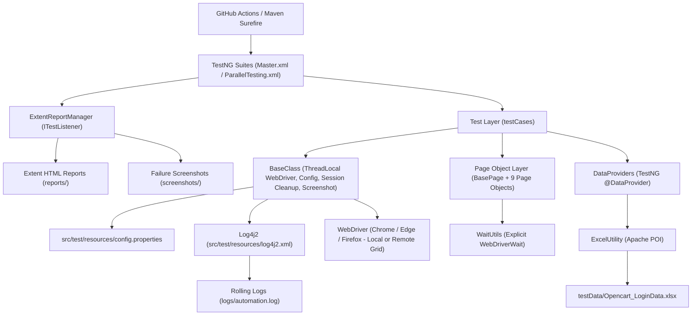

# OpenCart Selenium Java Automation Framework

An end-to-end UI test automation framework built with **Selenium WebDriver**, **Java**, **TestNG**, and **Maven** for testing the [OpenCart Demo Store](https://tutorialsninja.com/demo/). The framework implements the **Page Object Model (POM)** design pattern with thread-safe parallel execution, data-driven testing via Apache POI, structured Log4j2 logging, ExtentReports HTML reporting with automatic failure screenshots, and continuous integration via GitHub Actions.

---

## Table of Contents

1. [Project Overview](#1-project-overview)
2. [Key Features](#2-key-features)
3. [Technology Stack](#3-technology-stack)
4. [Framework Architecture](#4-framework-architecture)
5. [Project Folder Structure](#5-project-folder-structure)
6. [Design Pattern: Page Object Model](#6-design-pattern-page-object-model)
7. [Test Coverage](#7-test-coverage)
8. [Test Data Management](#8-test-data-management)
9. [Reporting and Logging](#9-reporting-and-logging)
10. [Screenshot Capture on Test Failure](#10-screenshot-capture-on-test-failure)
11. [How to Clone the Repository](#11-how-to-clone-the-repository)
12. [Prerequisites and Environment Setup](#12-prerequisites-and-environment-setup)
13. [How to Execute Tests Using Maven](#13-how-to-execute-tests-using-maven)
14. [How to Execute the TestNG Suite](#14-how-to-execute-the-testng-suite)
15. [GitHub Actions CI Workflow](#15-github-actions-ci-workflow)
16. [Sample Test Execution Results](#16-sample-test-execution-results)
17. [Future Enhancements](#17-future-enhancements)

---

## 1. Project Overview

This repository demonstrates a structured, maintainable test automation suite covering core e-commerce customer journeys on the OpenCart web application:

- Customer account registration (positive, duplicate email, and field-level validation checks)
- Authentication and negative login validation
- Product search, sorting, and empty-result handling (independent of login state)
- Single-product and multi-product shopping cart operations with dynamic price recalculation
- Full end-to-end guest checkout flow through order confirmation
- Excel-driven login testing across valid and invalid credential datasets

---

## 2. Key Features

- **Page Object Model (POM) with PageFactory:** Clean separation between UI element locators/actions (`pageObjects`) and test assertions (`testCases`).
- **Thread-Safe WebDriver Management:** Uses `ThreadLocal<WebDriver>` in `BaseClass` to support parallel cross-browser execution (`Chrome`, `Edge`, `Firefox`) without driver collisions.
- **Explicit Synchronization Utility (`WaitUtils`):** Centralizes `WebDriverWait` and `ExpectedConditions` (visibility, clickability, invisibility, text presence, URL checks, and alerts) with a configurable default 10-second timeout.
- **Session Isolation:** Clears browser cookies in `@AfterMethod` (`cleanSession()`) so every test method starts with a clean state.
- **Local & Remote Grid Support:** Configurable via `config.properties` (`Execution_env=local` or `remote`) with built-in headless browser options for CI environments.
- **Dynamic Financial Assertions:** Reads live product unit prices, subtotals, shipping rates, and grand totals directly from the UI to calculate and verify expected cart and checkout totals dynamically rather than relying on hardcoded figures.
- **Data-Driven Testing (DDT):** Reads Excel datasets (`testData/Opencart_LoginData.xlsx`) using Apache POI and feeds them into TestNG via `@DataProvider`.
- **Automated Reporting & Diagnostics:** Generates dark-themed ExtentSpark HTML reports, embeds screenshots automatically on failure, and writes rolling logs via Log4j2.
- **CI Integration:** Automated execution on GitHub Actions using headless Chrome with artifact uploads for HTML reports, failure screenshots, and execution logs.

---

## 3. Technology Stack

| Category | Technology / Library | Version |
| :--- | :--- | :--- |
| **Language** | Java (JDK 17 in CI) | 17+ |
| **UI Automation** | Selenium WebDriver (`selenium-java`) | 4.40.0 |
| **Driver Management** | Selenium Manager / WebDriverManager | 5.8.0 |
| **Test Runner** | TestNG | 7.12.0 |
| **Build Tool** | Apache Maven (`maven-surefire-plugin` / `maven-compiler-plugin`) | 3.5.5 / 3.15.0 |
| **Data-Driven Testing** | Apache POI (`poi`, `poi-ooxml`) | 5.5.1 |
| **Reporting** | ExtentReports (`extentreports`) | 5.1.2 |
| **Logging** | Apache Log4j2 (`log4j-core`, `log4j-api`) | 2.25.3 |
| **Utilities** | Apache Commons IO / Commons Lang3 | 2.21.0 / 3.20.0 |
| **CI/CD** | GitHub Actions | `ubuntu-latest` |

---

## 4. Framework Architecture

The framework is organized into four distinct layers so changes to page locators, test data, or execution infrastructure remain isolated from test logic.



---

## 5. Project Folder Structure

```text
opencart-Automation/
├── .github/
│   └── workflows/
│       └── maven-test.yml                     # GitHub Actions CI workflow
├── src/
│   └── test/
│       ├── java/
│       │   ├── pageObjects/
│       │   │   ├── BasePage.java              # PageFactory init & WaitUtils wrappers
│       │   │   ├── HomePage.java              # Header navigation & account dropdown
│       │   │   ├── AccountRegistrationPage.java # Registration form & field validations
│       │   │   ├── LoginPage.java             # Login form & warning messages
│       │   │   ├── MyAccountPage.java         # Account dashboard verification
│       │   │   ├── SearchPage.java            # Search bar, sorting, product selection
│       │   │   ├── ProductDisplayPage.java    # PDP actions & add-to-cart alerts
│       │   │   ├── ShoppingCartPage.java      # Multi-row cart operations & price parsing
│       │   │   └── CheckoutPage.java          # Multi-step guest checkout & order summary
│       │   ├── testBase/
│       │   │   └── BaseClass.java             # Driver lifecycle, config, random data, screenshots
│       │   ├── testCases/
│       │   │   ├── AccountRegistrationTest.java
│       │   │   ├── LoginTest.java
│       │   │   ├── SearchTest.java
│       │   │   ├── ShoppingCartTest.java
│       │   │   ├── EndToEndCheckoutTest.java
│       │   │   └── DDTTestcase.java
│       │   └── utilities/
│       │       ├── WaitUtils.java             # Explicit wait helper methods
│       │       ├── ExcelUtility.java          # Apache POI Excel reader/writer
│       │       ├── DataProviders.java         # TestNG @DataProvider for DDT
│       │       └── ExtentReportManager.java   # TestNG listener for ExtentReports
│       └── resources/
│           ├── config.properties              # Environment, URL, and test settings
│           └── log4j2.xml                     # Console & rolling file logger configuration
├── testData/
│   └── Opencart_LoginData.xlsx                # Excel test data for login DDT
├── logs/                                      # Runtime automation logs (gitignored)
├── reports/                                   # ExtentReports HTML output (gitignored)
├── screenshots/                               # Failure PNG captures (gitignored)
├── Master.xml                                 # Primary regression TestNG suite
├── ParallelTesting.xml                        # Cross-browser parallel TestNG suite
├── pom.xml                                    # Maven dependencies & Surefire config
├── run.bat                                    # Local Windows Maven execution script
└── .gitignore                                 # Excludes build, IDE, and generated artifacts
```

---

## 6. Design Pattern: Page Object Model

Every application screen is encapsulated in its own class under `src/test/java/pageObjects/`, extending `BasePage`:

- **`BasePage`**: Initializes `PageFactory.initElements(driver, this)` and instantiates `WaitUtils(driver)`, exposing clean helper methods (`waitForVisibility`, `waitForClickability`, `waitForInvisibility`, `waitForTextToBePresent`) to all subclasses.
- **`HomePage`**: Manages navigation to Register, Login, and Logout links under the My Account menu.
- **`AccountRegistrationPage`**: Handles registration form inputs, privacy policy checkbox, newsletter subscription, confirmation messages, top alert warnings, and all five individual field-level validation messages.
- **`LoginPage` & `MyAccountPage`**: Encapsulate login credentials input, invalid login alert extraction, and My Account page verification.
- **`SearchPage` & `ProductDisplayPage`**: Handle product keyword searches, sorting dropdown selection, no-results verification, navigating to product details, and adding products to the cart.
- **`ShoppingCartPage`**: Supports single and indexed multi-row cart lookups (product name, quantity, unit price, line total), quantity updates, item removal, empty-cart checks, and numeric parsing of currency values for dynamic total assertions.
- **`CheckoutPage`**: Orchestrates the 6-step OpenCart guest checkout accordion (Guest selection, Billing details, Delivery method, Payment method & terms agreement, Step 6 financial totals verification, and Order confirmation).

---

## 7. Test Coverage

The `Master.xml` suite executes **16 total test invocations** across 6 test classes:

### Registration (`AccountRegistrationTest`)
- **`verify_account_Register`**: Registers a new customer with dynamically generated unique data and verifies `"Your Account Has Been Created!"`.
- **`verify_registration_duplicate_email`**: Attempts registration using an already registered email and validates `"Warning: E-Mail Address is already registered!"`.
- **`verify_registration_empty_mandatory_fields`**: Submits an empty registration form and asserts both the Privacy Policy warning banner and all 5 field-level error messages (First Name, Last Name, E-Mail, Telephone, Password).

### Login (`LoginTest`)
- **`verify_Login`**: Logs in with valid credentials from configuration, validates the My Account page is displayed, and logs out cleanly.
- **`verify_Login_Invalid_Credentials`**: Submits randomly generated invalid credentials and asserts `"Warning: No match for E-Mail Address and/or Password."`.

### Search (`SearchTest`)
- **`verify_Search`**: Executes in a guest session (decoupled from authentication), searches for the configured product, sorts results by `"Name (Z - A)"`, adds the product to the cart, and verifies the success alert.
- **`verify_Search_Non_Existing_Product`**: Searches for a non-existent string and verifies `"There is no product that matches the search criteria."`.

### Shopping Cart (`ShoppingCartTest`)
- **`verify_update_cart_quantity`**: Adds `"HP LP3065"` to the cart, reads live unit prices, updates quantity from `1` to `2`, and dynamically asserts recalculated line total, subtotal, and grand total.
- **`verify_remove_product_from_cart`**: Adds a product, removes it from the cart, and verifies `"Your shopping cart is empty!"`.
- **`verify_multi_product_cart_operations`**: Adds two distinct products (`"HP LP3065"` and `"HTC Touch HD"`), verifies both items and initial totals dynamically, updates Row 1 quantity to `2` and validates recalculated totals, removes Row 1, and asserts the remaining item and recalculated totals.

### End-to-End Checkout (`EndToEndCheckoutTest`)
- **`verify_EndToEnd_Guest_Checkout`**: Executes the full purchase workflow: Search in-stock product (`"HP LP3065"`) -> Product Display Page -> Add to Cart -> Shopping Cart price verification -> Guest Checkout -> Billing Details -> Delivery Method -> Payment Method & Terms -> Step 6 dynamic financial validation (`Net Product Total + Shipping Rate = Grand Total`) -> Order Confirmation (`"Your order has been placed!"`).

### Data-Driven Testing (`DDTTestcase`)
- **`veriffy_loginDDT`**: Runs 5 iterations driven by `@DataProvider(name = "LoginData")` from `testData/Opencart_LoginData.xlsx`, validating both `Valid` and `Invalid` expected outcomes and logging out after successful logins to isolate iterations.

---

## 8. Test Data Management

The framework combines three complementary test data strategies:

1. **External Configuration (`src/test/resources/config.properties`)**:
   Controls execution mode, target URL, search term, and default test credentials:
   ```properties
   Execution_env=local
   appurl=https://tutorialsninja.com/demo/
   email=your-test-account@example.com
   password=your-test-password
   searchproductname=iphone
   ```
   *(Replace placeholder values locally when running against your own test account.)*

2. **Excel Spreadsheets (`testData/Opencart_LoginData.xlsx`)**:
   Read dynamically via `ExcelUtility` (Apache POI `XSSFWorkbook` and `DataFormatter`) and supplied to `DDTTestcase` through `DataProviders.getdata()`.

3. **Dynamic Runtime Data (`BaseClass`)**:
   Prevents duplicate-data collisions across repeated suite executions using Apache Commons Lang3:
   - `randomEmail()` — generates timestamped unique emails (`user_<5chars><timestamp>@test.com`)
   - `randomString()` — 6-character alphabetic strings for names
   - `randomNumber()` — 10-digit telephone numbers
   - `randomAlphaNumeric()` — 8-character passwords

---

## 9. Reporting and Logging

### ExtentReports (`utilities/ExtentReportManager.java`)
- Registered globally as a TestNG `<listener>` in both `Master.xml` and `ParallelTesting.xml`.
- Uses `ThreadLocal<ExtentTest>` for safe concurrent logging during parallel execution.
- Produces timestamped dark-themed HTML reports under `reports/Test-Report-yyyy.MM.dd.HH.mm.ss.html` containing test status (`PASS`, `FAIL`, `SKIP`), stack traces, OS/browser metadata, and embedded failure screenshots.
- Automatically opens the report in the default browser at the end of a local desktop run, while safely skipping browser launch in headless/CI environments (`!GraphicsEnvironment.isHeadless()`).

### Log4j2 (`src/test/resources/log4j2.xml`)
- Configured at `INFO` level with dual appenders:
  - **Console Appender:** Prints timestamped step logs to `SYSTEM_OUT`.
  - **RollingFile Appender:** Writes execution logs to `./logs/automation.log` and archives compressed rollovers (`./logs/automation-MM-dd-yyyy-i.log.gz`) whenever the file exceeds 50 KB.

---

## 10. Screenshot Capture on Test Failure

When any `@Test` method fails, `ExtentReportManager.onTestFailure(ITestResult result)` automatically:

1. Logs the `FAIL` status and full exception stack trace to the report.
2. Calls `BaseClass.captureScreen(testName)` using the thread's active `WebDriver` cast to `TakesScreenshot`.
3. Saves the PNG capture to `./screenshots/<testName>_yyyyMMddHHmmss.png`.
4. Attaches the screenshot directly inside the corresponding failed test entry in the Extent HTML report via `addScreenCaptureFromPath()`.

---

## 11. How to Clone the Repository

```bash
git clone https://github.com/DHANUSHIG/OpenCart-Automation.git
cd OpenCart-Automation
```

---

## 12. Prerequisites and Environment Setup

Ensure the following tools are installed and available on your system `PATH`:

- **Java Development Kit (JDK):** Version 17 or higher (`java -version`)
- **Apache Maven:** Version 3.8+ (`mvn -version`)
- **Web Browser:** Google Chrome (default), Microsoft Edge, or Mozilla Firefox
- **IDE (Optional):** Eclipse, IntelliJ IDEA, or VS Code with TestNG and Maven plugins

Verify dependencies and compile the project:

```bash
mvn test-compile
```

---

## 13. How to Execute Tests Using Maven

`pom.xml` configures `maven-surefire-plugin` to run `Master.xml` by default.

**Run the full regression suite (`Master.xml`) in standard mode:**
```bash
mvn clean test
```

**Run in headless mode (recommended for CI or background runs):**
```bash
mvn clean test -Dheadless=true
```

**Run the cross-browser parallel suite (`ParallelTesting.xml`):**
```bash
mvn clean test -Dsurefire.suiteXmlFiles=ParallelTesting.xml
```

**Run the cross-browser parallel suite in headless mode:**
```bash
mvn clean test -Dheadless=true -Dsurefire.suiteXmlFiles=ParallelTesting.xml
```

**Run a single test class:**
```bash
mvn test -Dtest=ShoppingCartTest
```

---

## 14. How to Execute the TestNG Suite

### From an IDE (Eclipse / IntelliJ IDEA)
1. Import the project as an **Existing Maven Project**.
2. Right-click **`Master.xml`** (or **`ParallelTesting.xml`**) in the project root.
3. Select **Run As -> TestNG Suite**.

### Using the Included Windows Batch Script
Update the project path inside `run.bat` if needed, then run:
```cmd
run.bat
```

---

## 15. GitHub Actions CI Workflow

Continuous integration is defined in [`.github/workflows/maven-test.yml`](.github/workflows/maven-test.yml).

### Workflow Configuration Summary

- **Workflow Location:** `.github/workflows/maven-test.yml`
- **Runner Environment:** `ubuntu-latest` (timeout: `30` minutes)
- **Trigger Conditions:**
  - Automatic execution on `push` to `main` or `master`
  - Automatic execution on `pull_request` targeting `main` or `master`
  - Manual trigger via `workflow_dispatch` with selectable inputs:
    - `browser`: `chrome` (default), `firefox`, `edge`
    - `suite`: `Master.xml` (default), `ParallelTesting.xml`
    - `headless`: `true` (default), `false`
- **Java & Maven Setup:**
  - Checks out source code using `actions/checkout@v4`
  - Installs **JDK 17 (Eclipse Temurin)** with Maven dependency caching via `actions/setup-java@v4`
- **Headless Browser Execution Command:**
  ```bash
  mvn clean test \
    -Dbrowser=${{ github.event.inputs.browser || 'chrome' }} \
    -Dheadless=${{ github.event.inputs.headless || 'true' }} \
    -Dsurefire.suiteXmlFiles=${{ github.event.inputs.suite || 'Master.xml' }}
  ```
- **Uploaded CI Artifacts (`if: always()`):**
  - **`extent-reports`** (`reports/*.html`, retained 14 days)
  - **`failure-screenshots`** (`screenshots/*.png`, retained 14 days)
  - **`automation-logs`** (`logs/`, retained 7 days)

---

## 16. Sample Test Execution Results

Verified local Maven Surefire execution of `Master.xml`:

```text
-------------------------------------------------------------------------------
Test set: TestSuite
-------------------------------------------------------------------------------
Tests run: 16, Failures: 0, Errors: 0, Skipped: 0, Time elapsed: 111.0 s -- in TestSuite
```

| Test Class | Test Cases Executed | Scope | Status |
| :--- | :---: | :--- | :---: |
| `AccountRegistrationTest` | 3 | Positive registration, duplicate email, empty mandatory fields | Passed |
| `LoginTest` | 2 | Valid login/logout, invalid credentials warning | Passed |
| `SearchTest` | 2 | Guest search & sort/add-to-cart, non-existing product check | Passed |
| `ShoppingCartTest` | 3 | Quantity update, item removal, multi-product dynamic totals | Passed |
| `EndToEndCheckoutTest` | 1 | Full guest checkout with dynamic total & order confirmation | Passed |
| `DDTTestcase` | 5 | Excel-driven login matrix (`Opencart_LoginData.xlsx`) | Passed |
| **Total** | **16** | **Full Master Regression Suite** | **16 / 16 Passed** |

---

## 17. Future Enhancements

- **Environment Variable / Secret Injection:** Support overriding `email`, `password`, and `appurl` via `-D` system properties or GitHub Secrets in `BaseClass` to completely decouple credentials from `config.properties`.
- **Browser CLI Override Support:** Read `-Dbrowser` directly in `BaseClass.setup()` so Maven CLI and GitHub Actions `workflow_dispatch` browser selection overrides the XML `<parameter name="browser">` value dynamically.
- **Registered User Checkout & Order History:** Expand `EndToEndCheckoutTest` to cover logged-in customer checkout and order verification under Account Order History.
- **Dockerized Selenium Grid Execution:** Add a `docker-compose.yml` setup for running `ParallelTesting.xml` against containerized Chrome, Firefox, and Edge Grid nodes.
- **Retry Analyzer for Flaky Network Conditions:** Implement a TestNG `IRetryAnalyzer` to handle transient network timeouts on public demo servers.
